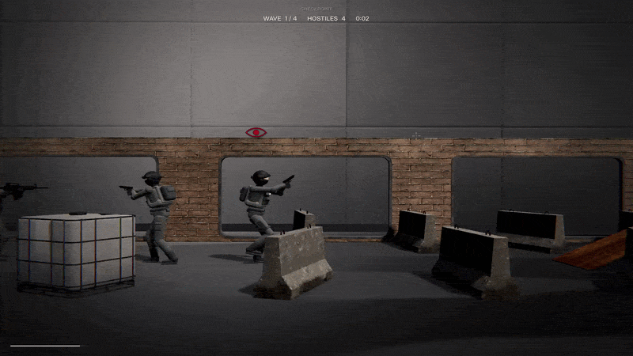
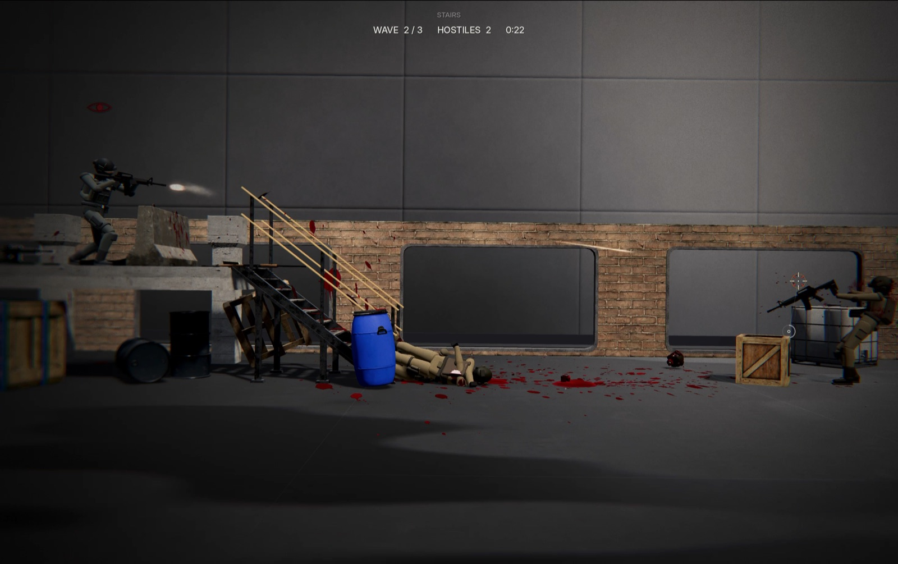
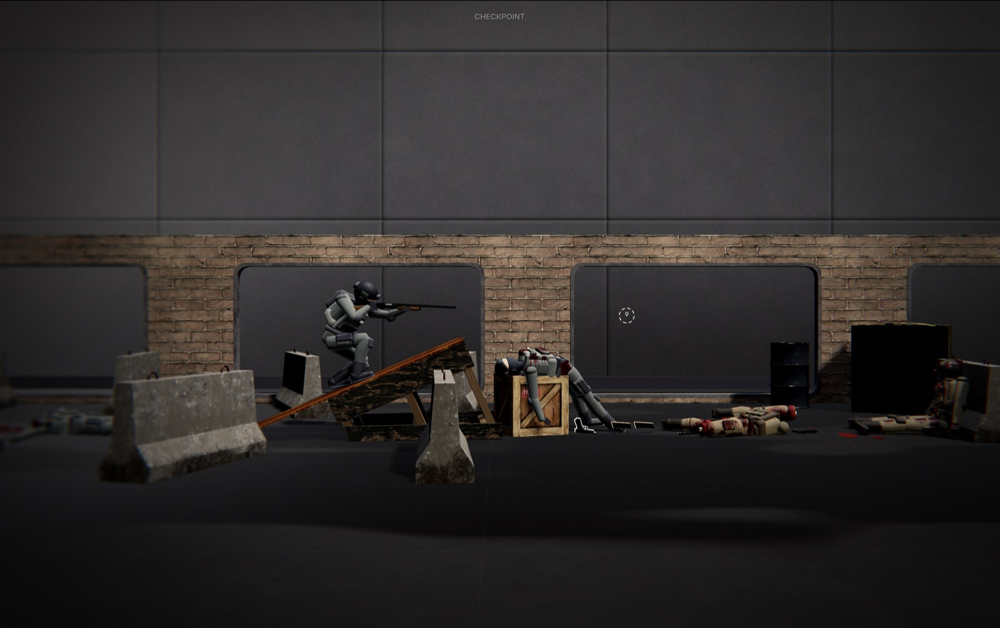
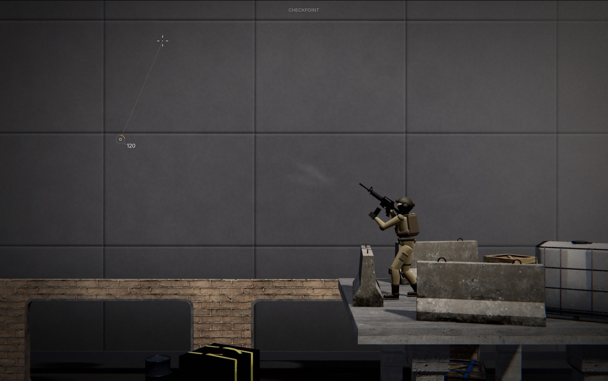
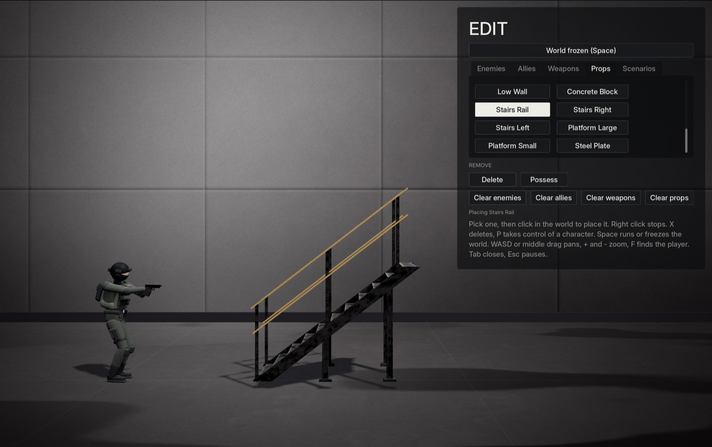

<p align="center">
  
</p>

<p align="center">
  <i>A 2.5D physics based sandbox shooter with ragdolls, AI, and stylised gore, built in Godot.</i>
</p>

<p align="center">
  
  <br>
  <a href="">Live demo</a>
</p>

> [!NOTE]
> Contains stylised gore, including blood and dismemberment. All of it can be turned off in the settings menu.

## About

A 2.5D sandbox shooter built in Godot, where every character is a physics driven active ragdoll. Movement, aiming and gun handling are all animated procedurally (there are no animation clips, everything is handled in code), so bodies react dynamically to the environment. Enemies have a pretty robust AI, where they react based on sight, noise or discovered bodies, and can traverse the level with ease. You can also create your own levels or play preset levels.

This project was originally meant to be a simple 2.5D shooter with animations, but after seeing a project on Unity which used no animation clips and felt really fun, I decided to try something similar. It isn't meant to be realistic but I wanted the fights to be somewhat chaotic and overall fun.

## Features

- Active ragdoll characters with fully procedural movement
- Procedural gun handling
- Multiple weapon types (pistol, rifle, shotgun, sniper)
- Smart AI and stealth functionality
- Bullet penetration based on material
- Blood, bleeding, dismemberment, and healing using bandages
- Stamina, fall damage, and slow motion effect
- Level editor with props and character placement
- Dynamic world audio
- Runs in the browser

## Screenshots

<p align="center">
  
  
  
  
</p>

## Controls

| Key       | Action           |
| --------- | ---------------- |
| `A` / `D` | Move             |
| `Space`   | Jump             |
| `Shift`   | Sprint           |
| `C`       | Crouch           |
| `LMB`     | Shoot            |
| `RMB`     | Aim down sights  |
| `R`       | Reload           |
| `B`       | Switch fire mode |
| `E`       | Swap weapon      |
| `F`       | Use bandage      |
| `Q`       | Slow motion      |
| `Esc`     | Pause            |

_Additional controls are listed in the in game controls menu._

## Technology

- Godot
- GDScript
- GDShader
- Jolt Physics

## Development Notes

- **No animation clips.** This was the hardest part to achieve, since there was a lot of trial and error and tuning that was needed to be done to get where the project is right now and for things to feel good.
- **Gun handling.** This was another challenging part to get right, since every part of the gun is animated (including the slide, trigger, bullets getting chambered, etc.) and this was made harder since there are multiple gun types and each gun has its own system so things had to be reusable.
- **Legs getting stuck.** Legs/feet originally clipped through or got stuck on props and ledges or more complex terrain in general. That was a nightmare to fix and get right too (and it still isn't perfect).
- **Bullet penetration.** Bullets can pass through softer materials like flesh and wood, but not stronger ones.
- **Dismemberment.** This was fun to make, and it gave the game the gritty feel I was going for.
- **AI.** Enemies went from very simple to being able to see and hear the player, and I added stealth mechanics on top.
- **Web export.** The game lagged in the browser (and even locally) when there were many enemies, so I had to optimize a lot.

## Running Locally

Clone the repository:

```bash
git clone https://github.com/RealAbdurRehman/impulse.git
```

Open Godot 4.7, click **Import**, and select the `project.godot` file in the cloned folder. Then press `F5` to run the game.

## AI Disclosure

I used AI (Claude) throughout development, mainly to write and debug GDScript and shaders, especially for complex systems like the gait system that I didn't know how to build myself. I did all of the tuning, polishing, and less complex features.
